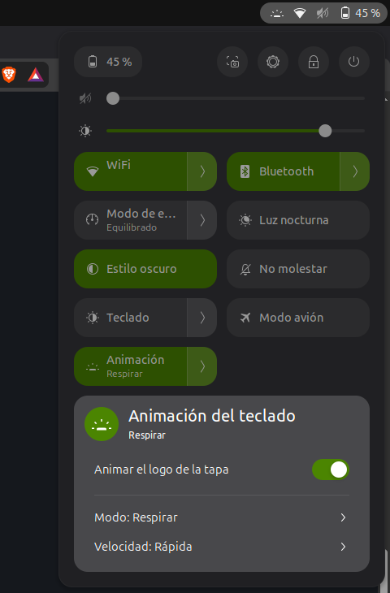
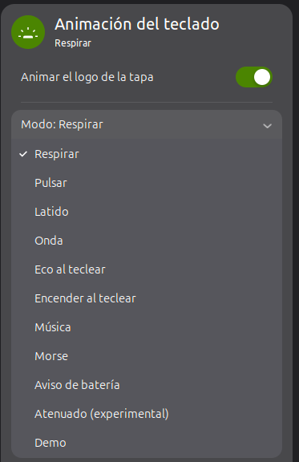
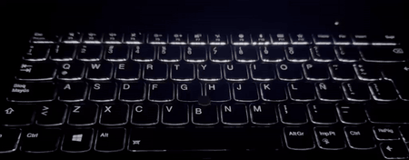
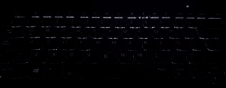
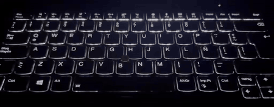

# kbdfx

**APLDTTP** · **A**nimación **P**ara **L**ed **D**e **T**eclado **T**hink**P**ad · Todos los modelos

Animaciones para la retroiluminación del teclado de las **Lenovo ThinkPad** en Linux: pulsos, respiración, latido, código Morse, reacción al teclear, ritmo de la música y alertas de batería.

<!-- GIF PRINCIPAL: graba el teclado con varios modos y guárdalo como docs/gifs/demo.gif -->
<!-- PENDIENTE: quita este comentario cuando tengas el GIF
<p align="center">
  
</p>
-->

Funciona en cualquier ThinkPad con teclado retroiluminado que use el driver `thinkpad_acpi`. Se probó en la T480s; para comprobar la tuya, mira [Comprueba la compatibilidad](#comprueba-la-compatibilidad).

> **No modifica el firmware ni la BIOS.** El programa escribe en la interfaz del driver `thinkpad_acpi`, así que no hay riesgo de dañar la laptop. Al detenerlo, la luz vuelve a como estaba.

---

## Contenido

- [Qué puede hacer](#qué-puede-hacer)
- [Requisitos](#requisitos)
- [Instalación](#instalación)
- [Menú](#menú)
- [Botón en los ajustes rápidos](#botón-en-los-ajustes-rápidos-gnome)
- [Modos](#modos)
- [Opciones](#opciones)
- [Arranque automático](#arranque-automático)
- [Solución de problemas](#solución-de-problemas)
- [Desinstalar](#desinstalar)
- [Cómo funciona](#cómo-funciona)

---

## Qué puede hacer

La luz del teclado de la T480s es **blanca, de una sola zona y con 3 niveles**:

| Nivel | Estado  |
|:-----:|---------|
| `0`   | Apagada |
| `1`   | Baja    |
| `2`   | Alta    |

Todas las animaciones se construyen con esos tres niveles. El hardware no tiene colores ni control por tecla: todas las teclas comparten la misma luz, así que no se puede encender solo una zona del teclado.

---

## Requisitos

| Requisito          | Detalle                                                    | Obligatorio |
|--------------------|------------------------------------------------------------|:-----------:|
| Laptop             | Cualquier ThinkPad con luz de teclado (probado en la T480s) | Sí          |
| Linux              | Cualquier distro; pensado para Ubuntu                      | Sí          |
| `thinkpad_acpi`    | Driver del kernel, activado por defecto                    | Sí          |
| Python 3           | Ya viene instalado en Ubuntu                               | Sí          |
| `sudo`             | Solo una vez, para instalar                                | Sí          |
| `pulseaudio-utils` | Da el comando `parec`; solo para el modo `musica`          | No          |

### Comprueba la compatibilidad

Ejecuta un comando a la vez:

```bash
ls /sys/class/leds/ | grep -i tpacpi
cat /sys/class/leds/tpacpi::kbd_backlight/max_brightness
```

Si aparece `tpacpi::kbd_backlight` y el segundo comando responde `2`, todo está listo.

---

## Instalación

```bash
git clone https://github.com/TU_USUARIO/kbdfx.git
cd kbdfx
bash install.sh
```

Si descargaste el `.zip`, descomprímelo, entra a la carpeta `kbdfx` y ejecuta `bash install.sh`.

El instalador hace tres cosas:

1. Copia el programa a `/usr/local/bin/kbdfx`.
2. Crea una regla udev para que puedas controlar la luz **sin `sudo`**.
3. Prepara un servicio de usuario para el arranque automático, que es opcional.
4. Agrega **Luces del teclado** al menú de aplicaciones.
5. Instala la extensión de GNOME con el botón **Animación** en los ajustes rápidos. Cierra sesión y vuelve a entrar para verlo.

Pruébalo:

```bash
kbdfx
```

---

## Menú

Escribe `kbdfx` sin nada más, o abre **Luces del teclado** desde tus aplicaciones. Aparece un menú para elegir el modo con un número:

<!-- GIF DEL MENÚ: graba la terminal eligiendo un modo y guárdalo como docs/gifs/menu.gif -->
<!-- PENDIENTE: quita este comentario cuando tengas el GIF
<p align="center">
  
</p>
-->

```
  kbdfx - luces del teclado ThinkPad
  Arranque automatico: ninguno

   1  pulsar    Parpadeo de apagado a alto
   2  respirar  Sube y baja: 0, 1, 2, 1
   ...
  12  fijo      Deja un nivel fijo (0, 1 o 2)

   a  Guardar un modo como arranque automatico
   x  Quitar el arranque automatico
   q  Salir
```

- Elige un número y el menú te pregunta las opciones de ese modo. Pulsa **Enter** para dejar el valor sugerido.
- **Ctrl + C** detiene la animación y te devuelve al menú.
- Con **a** guardas un modo, con sus opciones, para que arranque solo al iniciar sesión. Con **x** lo quitas.
- Mientras usas el menú, el arranque automático se pausa para no interferir y se reanuda al salir.

Si prefieres escribir los comandos directamente, siguen funcionando igual (ver [Modos](#modos)).

---

## Botón en los ajustes rápidos (GNOME)

En Ubuntu con GNOME, el instalador agrega un botón **Animación** al panel de ajustes rápidos, el de la esquina superior derecha donde están Wi-Fi, Estilo oscuro y Teclado.

<p align="center">
  
  &nbsp;&nbsp;
  
</p>

- **Pulsa el botón** para encender o apagar la animación.
- **La flecha `>`** abre el interruptor del logo de la tapa y dos listas plegables: **Modo** y **Velocidad** (lenta, normal, rápida). Pulsa una para desplegarla; la de modos tiene desplazamiento.
- **Elegir un modo** con la animación apagada la enciende directamente.
- Mientras hay una animación, aparece un icono de teclado en la barra superior.
- Recuerda el último modo y si estaba encendido, así que al iniciar sesión continúa donde lo dejaste.
- Al bloquear la pantalla, la animación se detiene y la luz vuelve a como estaba. Al desbloquear, continúa.
- El texto del modo Morse se cambia en `~/.config/kbdfx/extension.json` (campo `texto_morse`).

Requisitos: GNOME 48 a 51. Probado para Ubuntu 26.04 (GNOME 50). Después de instalar hay que **cerrar sesión y volver a entrar** una vez.

> Usa **o** el botón **o** el arranque automático del menú (opción **a**), no los dos. Si están los dos, el botón pausa el arranque automático al encender una animación.

---

## Modos

| Comando                | Qué hace                                                   |
|------------------------|------------------------------------------------------------|
| `kbdfx pulsar`         | Parpadeo de apagado a alto                                 |
| `kbdfx respirar`       | Sube y baja: 0, 1, 2, 1                                     |
| `kbdfx latido`         | Dos pulsos rápidos y una pausa, como un corazón            |
| `kbdfx onda`           | Oscila entre bajo y alto y luego descansa                  |
| `kbdfx demo`           | Recorre los modos anteriores, 6 segundos cada uno          |
| `kbdfx morse "hola"`   | Escribe el texto en código Morse con la luz                |
| `kbdfx teclear -t 5`   | Se enciende al escribir y se apaga tras 5 s sin teclear    |
| `kbdfx eco`            | Cada tecla da un destello que se desvanece: alto, bajo, apagado |
| `kbdfx musica`         | El brillo sigue el volumen de lo que suena                 |
| `kbdfx bateria -u 15`  | Parpadea si la batería baja del 15 % y no está cargando    |
| `kbdfx atenuado`       | Respiración suave con brillos intermedios (experimental)   |
| `kbdfx fijo 1`         | Deja un nivel fijo (0, 1 o 2) y termina                    |

### Galería

Algunos modos en acción:

| Pulsar | Respirar |
|:------:|:--------:|
|  |  |

| Latido | Onda |
|:------:|:----:|
|  |  |

Además de estos, kbdfx incluye:

- **Teclear:** la luz se enciende al escribir y se apaga tras unos segundos sin teclear.
- **Eco:** cada tecla da un destello que se desvanece.
- **Música:** el brillo sigue el volumen de lo que suena.
- **Morse:** escribe un texto en código Morse con la luz.
- **Batería:** parpadea cuando la batería baja del umbral y no está cargando.
- **Atenuado (experimental):** respiración suave con brillos intermedios.
- **Logo de la tapa (`--logo`):** anima también el punto rojo del logo con cualquier modo.

---

## Opciones

Sirven para cualquier modo:

| Opción            | Efecto                                           | Ejemplo               |
|-------------------|--------------------------------------------------|-----------------------|
| `-v, --velocidad` | Multiplica la velocidad (1 = normal)             | `kbdfx latido -v 2`   |
| `-l, --logo`      | Anima también el punto rojo del logo de la tapa  | `kbdfx pulsar --logo` |

Solo para algunos modos:

| Opción               | Modo       | Efecto                                                       |
|----------------------|------------|--------------------------------------------------------------|
| `-t, --tiempo`       | `teclear`  | Segundos sin teclear antes de apagarse (por defecto 5)       |
| `-c, --cola`         | `eco`      | Cuánto se acumula al escribir rápido; mayor = tarda más en apagarse (por defecto 2) |
| `-s, --sensibilidad` | `musica`   | Menor número = reacciona más; prueba `0.7`                   |
| `-u, --umbral`       | `bateria`  | Porcentaje de aviso (por defecto 15)                         |
| `--hz`               | `atenuado` | Frecuencia del parpadeo rápido; prueba 50 o 120 si ves parpadeo |

Ayuda completa: `kbdfx --help` o `kbdfx <modo> --help`.

---

## Arranque automático

Lo más fácil es usar la opción **a** del [menú](#menú), que además guarda las opciones que elijas.

También puedes hacerlo con comandos (cambia `teclear` por el modo que quieras):

```bash
systemctl --user enable --now kbdfx@teclear     # activar
systemctl --user disable --now kbdfx@teclear    # desactivar
systemctl --user status kbdfx@teclear           # ver si está corriendo
```

El servicio usa los valores por defecto de cada modo. Solo puede haber un modo activo a la vez, así que desactiva uno antes de activar otro.

---

## Solución de problemas

| Síntoma                                       | Solución                                                        |
|-----------------------------------------------|-----------------------------------------------------------------|
| "Sin permiso para escribir la luz"            | Vuelve a ejecutar `bash install.sh` o reinicia la laptop.       |
| `kbdfx: orden no encontrada`                  | La instalación no terminó; repite `bash install.sh`.            |
| "Falta 'parec'" en el modo música             | `sudo apt install pulseaudio-utils`                             |
| El modo música no reacciona                   | Sube el volumen o usa `-s 0.6`.                                 |
| No aparece el botón **Animación**             | Cierra sesión y vuelve a entrar. Si sigue sin aparecer: `gnome-extensions enable kbdfx@kbdfx.local` |
| El botón se apaga solo y muestra un aviso     | El aviso trae el error de kbdfx; prueba el mismo modo en la terminal para verlo completo. |
| Los modos teclear o eco no reaccionan         | Solo detecta el teclado interno, no uno USB externo.            |
| La luz cambia sola con Fn + Espacio           | Es normal: el firmware cambia el nivel y la animación lo retoma. |
| Se enciende y se apaga al instante al probar a mano | Escribe los comandos de uno en uno; no pegues dos líneas juntas. |

---

## Desinstalar

```bash
systemctl --user disable --now kbdfx.service    # si lo activaste desde el menú
systemctl --user disable --now kbdfx@teclear    # si lo activaste con comandos
rm ~/.config/systemd/user/kbdfx@.service ~/.config/systemd/user/kbdfx.service
rm ~/.local/share/applications/kbdfx.desktop
gnome-extensions disable kbdfx@kbdfx.local
rm -r ~/.local/share/gnome-shell/extensions/kbdfx@kbdfx.local ~/.config/kbdfx
sudo rm /usr/local/bin/kbdfx /etc/udev/rules.d/90-kbdfx.rules
```

---

## Cómo funciona

- **Luz del teclado:** escribe `0`, `1` o `2` en `/sys/class/leds/tpacpi::kbd_backlight/brightness`.
- **Logo de la tapa:** usa `/sys/class/leds/tpacpi::lid_logo_dot/brightness`.
- **Modos teclear y eco:** cuentan las interrupciones del teclado interno (IRQ 1, `i8042`) en `/proc/interrupts`. Solo sabe **cuántas** veces se pulsa una tecla, nunca **cuáles**, así que no funciona como keylogger.
- **Modo eco:** cada tecla suma "energía" que se gasta con el tiempo; con mucha energía la luz está en alto, con poca en bajo y sin energía se apaga.
- **Modo música:** lee el audio de salida con `parec` y calcula el volumen cada ~50 ms.
- **Modo atenuado:** alterna niveles muy rápido (PWM por software) para simular brillos intermedios.
- **Permisos:** la regla udev hace escribible el archivo `brightness` al arrancar el sistema, para no necesitar `sudo`.

---

## Licencia

MIT <!-- cambia esto si prefieres otra licencia -->
